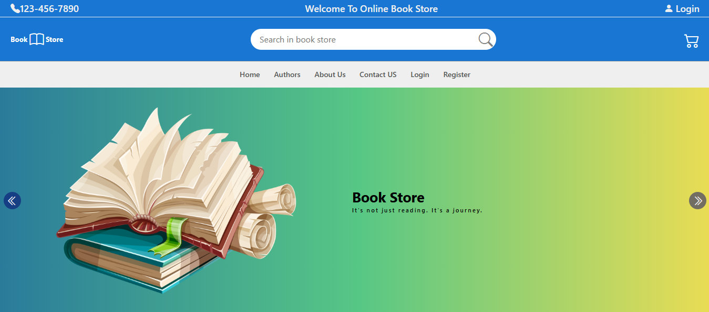
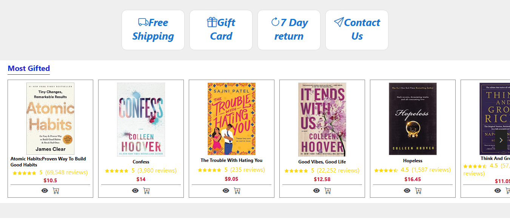
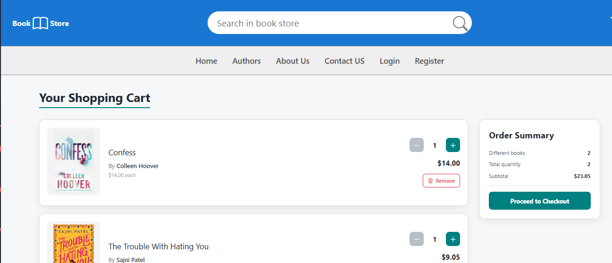
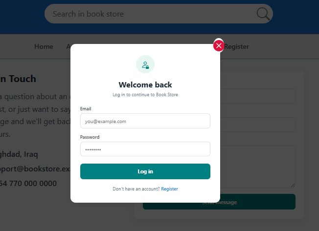
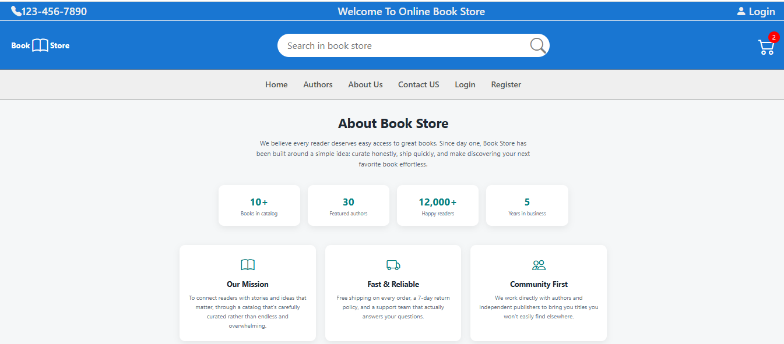

<div align="center">

# 📚 Book Store

**A full-featured e-commerce book store built with React 19 — catalog, live search, cart, multi-step checkout, and authentication.**

[](https://mustafacoder365.github.io/Book-Store-Application/)


<br>



</div>

---

## ✨ Highlights

- 🛒 **Shopping cart** with Context API and localStorage persistence
- 💳 **Multi-step checkout** — shipping form, order summary, and order confirmation
- 🔍 **Live search** by book title or author
- 🔐 **Login & register** as a modal (with mode switching) or standalone pages, with validation and persistent login state
- 👁️ **Quick-view modal** for any book
- 📱 **Fully responsive** — mobile, tablet, and desktop
- ♿ **Keyboard-accessible** interactive controls

## 📄 Pages

| Page | What it does |
|---|---|
| **Home** | Hero slider, services, and 3 curated carousels: Most Gifted, Best Seller, Most Wished For |
| **Book details** | Specs, quantity selector, add to cart, and related titles |
| **Authors** | Directory of 30 authors, each linked to search |
| **Cart** | Update quantities, remove items, live totals |
| **Checkout** | Shipping form → order summary → confirmation |
| **Login / Register** | Validated forms; logged-in user shown in the header with logout |
| **About / Contact** | Company info and a validated contact form |
| **404** | Friendly page for unmatched routes |

## 📸 Screenshots

| Catalog | Cart |
|---|---|
|  |  |

| Login | Register |
|---|---|
|  |  |

| About | Contact |
|---|---|
|  |  |

## 🛠️ Tech Stack

| Area | Tools |
|---|---|
| **Framework** | [React 19](https://react.dev/) + [Vite](https://vitejs.dev/) |
| **Routing** | [React Router 7](https://reactrouter.com/) (HashRouter, GitHub Pages-ready) |
| **State** | React Context — cart and auth |
| **Icons** | [Bootstrap Icons](https://icons.getbootstrap.com/) |
| **Styling** | Component-scoped CSS3 |
| **Quality** | ESLint |

## 📂 Project Structure

```
src/
├── components/   # Header, footer, sliders, modals, auth modal, search results…
├── context/      # Cart and auth providers + hooks
├── data/         # Books and authors data
├── pages/        # Home, Book, Authors, Cart, Checkout, Login, Register, About, Contact, 404
├── utils/        # Asset path helper
├── App.jsx
└── main.jsx
```

## 🚀 Getting Started

```bash
git clone https://github.com/MustafaCoder365/Book-Store-Application.git
cd Book-Store-Application
npm install
npm run dev
```

### Deploy to GitHub Pages

```bash
npm run deploy
```

Builds the app and publishes `dist` to the `gh-pages` branch.

## 👤 Author

**Mustafa Shakir** — Frontend Software Developer

[](https://github.com/MustafaCoder365)
[](https://www.linkedin.com/in/mustafa-shakir-840374330)
[](mailto:mustafa1997670@gmail.com)

⭐ If you like this project, give it a star!
